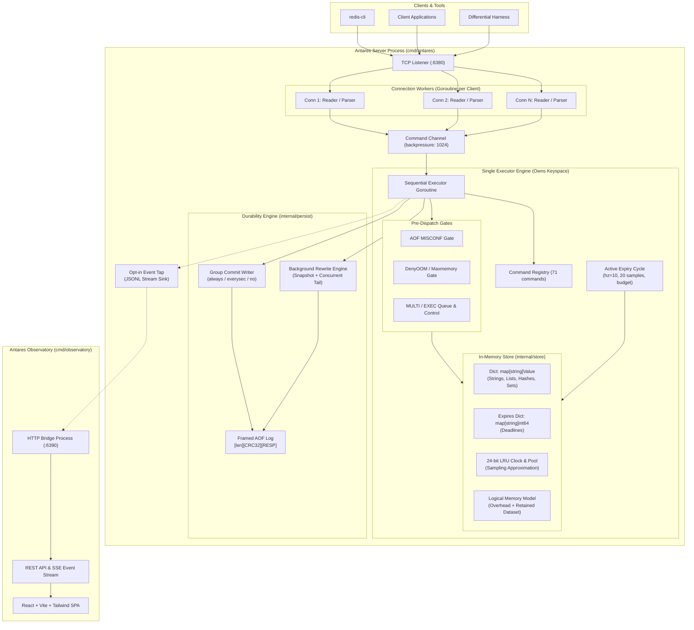
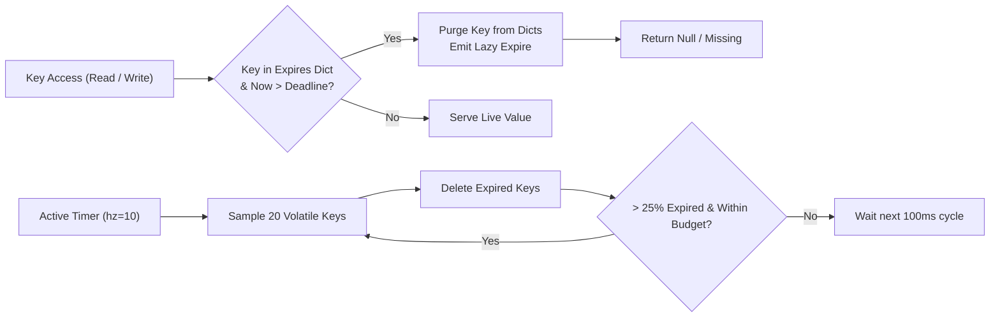
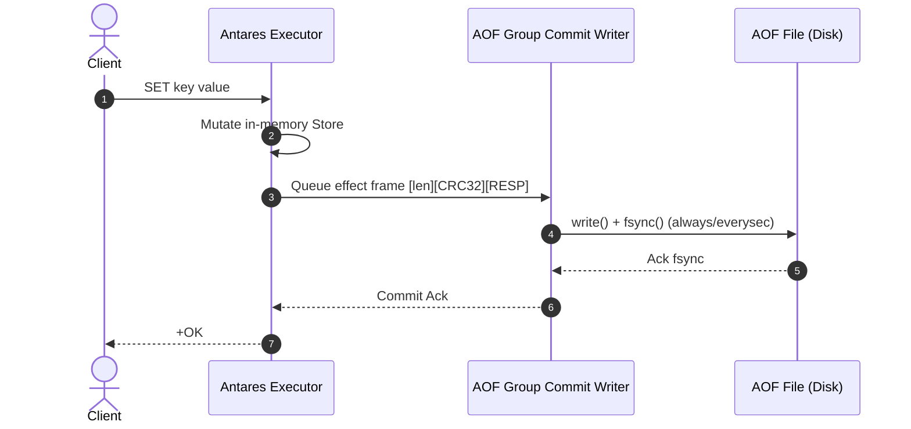

# Antares Architecture & System Design (PLAN P10.2)

> **Antares**: A high-performance, Redis-compatible in-memory data store written from scratch in Go, designed alongside the **Antares Observatory**.

---

## 1. High-Level System Architecture

Antares follows a clean separation between network I/O concurrency and keyspace execution, reproducing Redis's single-threaded sequential semantics while maintaining race-detector clean execution by construction (ADR-002).



---

## 2. Core Subsystems

### 2.1 Concurrency Model (ADR-002, ADR-031)
- **Network I/O**: Each incoming client connection is served by an independent I/O goroutine (`internal/server/server.go`) responsible for reading bytes, parsing RESP2 requests, and buffering pipeline responses.
- **Pipeline Batch Draining (`HandleBatch`)**: For pipelined commands ($P=16$), when `br.Buffered() > 0`, the connection goroutine drains up to 64 ready requests from memory into a batch slice and submits them to the executor in **a single channel dispatch with one completion signal**, cutting 93.75% of Go scheduler context switches.
- **Stateless Direct Fast Paths**: Commands like `PING` outside transactions bypass the executor channel entirely, writing static `+PONG\r\n` directly to the connection write buffer with atomic command counter updates.
- **Keyspace Execution**: All state-mutating and reading commands are dispatched across a bounded channel (capacity: 1024) into a single, dedicated **Executor goroutine**.
- **Benefits**:
  - Eliminates mutex contention and complex fine-grained locking over the keyspace.
  - Guarantees strict sequential operation order.
  - Inherently race-detector clean (`go test -race`).
  - Achieves over 3.33M rps under pipelined execution.

---

### 2.2 Wire Protocol, Parser & Storage Engine (ADR-003, ADR-031)
- **Protocol**: RESP2 binary-safe request reader and reply encoder (`internal/protocol`).
- **Zero-Allocation Stack Parsing**: Multi-bulk header decoding and integer parsing use stack-allocated scratch arrays (`[32]byte`, `[4]byte`), eliminating heap escapes on hot command paths.
- **Contiguous Collection Storage**:
  - **Lists**: Contiguous 2D byte slices (`[][]byte`) with geometric headroom doubling ($2 \times (\text{len} + n)$) and initial capacity of 256 elements, eliminating repeated reallocations on `LPUSH` and `RPUSH`.
  - **Sets & Hashes**: Slice-backed members paired with integer index lookups; set memory tracking is computed via an $O(1)$ arithmetic formula (`setMemoryUsage`) avoiding $O(N)$ full-scan penalties.
- **Pipelining**: Multiple commands per read packet are parsed and executed in order, batching reply flushes to network buffers via a 16 KB buffered writer.
- **Hardened Limits**:
  - 512 MiB maximum bulk string length (`proto-max-bulk-len`).
  - 1 GiB aggregate request size guard (`client-query-buffer-limit`).
  - Streaming payload reading prevents pre-allocating memory for declared lengths before bytes arrive.
- **Capture-Exact Errors**: Error strings, command unknown messages, and syntax replies are validated byte-for-byte against captured Redis 7.4.11 behavior.

---

### 2.3 Expiration Architecture (ADR-005, ADR-009)
Antares implements dual-strategy expiration:
1. **Lazy Expiration**: On every key access (read or write), the store checks the deadline in the `expires` dict. Expired keys are purged immediately and treated as missing.
2. **Active Expiration Cycle**: An internal timer (default `hz=10`) samples 20 keys with TTL per cycle. If >25% are expired, the cycle repeats up to an allotted time budget.
3. **Virtual Injected Clock (ADR-009)**: All time dependencies are driven by an injected `clock.Clock` interface (`internal/clock`), allowing tests to advance simulated time instantaneously without sleeping.



---

### 2.4 Persistence: Framed AOF & Rewrite (ADR-004, ADR-010, ADR-024)
- **Framed Format**: Every AOF record is encoded as `[u32 length][u32 IEEE CRC32][RESP payload]`.
- **Group Commit**: Concurrent writer requests are batched by a dedicated writer goroutine supporting `appendfsync always`, `everysec`, and `no`.
- **Durability & Crash Safety**:
  - `make crash-test` runs 100 iterations of random `kill -9` with zero acknowledged write loss under `always`.
  - Startup recovery replays valid prefixes and cleanly truncates torn tails (incomplete final frames). Corrupt frames (checksum mismatch or bad length) are refused unless `-aof-repair` is supplied.
  - **MISCONF Gate**: On write/disk failure, the server clamps to the last complete frame and rejects further mutations with `-MISCONF` while continuing to serve reads.
- **Background Rewrite (Compaction)**:
  - Generates state snapshots into `.tmp` files.
  - Buffers concurrent mutations in memory during rewrite.
  - Flushes buffered tail, performs atomic `rename`, and fsyncs the parent directory.



---

### 2.5 Memory Accounting & Approximated LRU Eviction (ADR-025, ADR-026, ADR-027)
- **Logical Memory Model**: Rather than relying on Go's runtime heap counter (which fluctuates with GC pacing), Antares tracks a logical model summing map/slice overhead and retained payload lengths, calibrated to within 10% of Go's retained heap.
- **`maxmemory` Enforcement**: Memory-expanding commands (`CMD_DENYOOM`: `SET`, `HSET`, `LPUSH`, `SADD`, etc.) are checked before execution. When over the limit:
  - Under `noeviction`: Fails with `-OOM command not allowed when used memory > 'maxmemory'`.
  - Under `allkeys-lru` / `volatile-lru`: Executes approximated LRU eviction.
- **Approximation Mechanism**:
  - 24-bit LRU clock stored on each `Value`, refreshed on lookup and mutation.
  - Samples 5 candidate keys into a 16-slot sorted idle pool.
  - Evicts the most idle key, appends a `DEL` to the AOF log, and repeats until the keyspace fits or no keys remain evictable.
  - Verified retention of hot keys under churn: **0.98–1.00** (gate >0.90).

---

### 2.6 Transactions & Concurrency (ADR-008, ADR-028)
- **`MULTI` / `EXEC` / `DISCARD`**:
  - Per-connection transaction state queues commands with `+QUEUED`.
  - Queue-time syntax/arity errors mark the transaction `dirty`, resulting in `-EXECABORT` at `EXEC`.
  - `EXEC` dispatches all queued operations in a single executor turn with atomic visibility.
  - AOF writes for all operations in a transaction are combined and emitted as a **single atomic AOF frame**.
- **`WATCH` / `UNWATCH`**:
  - Evaluated via value snapshots (existence, kind, payload, expiry deadline).
  - Writing the identical value does not trigger aborts (documented divergence ADR-008).

---

### 2.7 Verification Architecture (Pyramid)

Antares validates compatibility and performance across a verification pyramid:

```
                  ┌────────────────────────┐
                  │ 6. Claims Pipeline     │ (claims.json, UI trust)
                 ┌┴────────────────────────┴┐
                 │ 5. redis-benchmark Suite │ (P=1 >200k, P=16 >700k rps)
                ┌┴──────────────────────────┴┐
                │ 4. Fuzz Soaks (1h / ~890M) │ (Parser & AOF recovery)
               ┌┴────────────────────────────┴┐
               │ 3. 100x Crash Durability Lab │ (SIGKILL, zero acked loss)
              ┌┴──────────────────────────────┴┐
              │ 2. Official Tcl (65/65 pass)   │ (expire & incr suites)
             ┌┴────────────────────────────────┴┐
             │ 1. Differential Harness (1000+)  │ (0 mismatches vs Redis 7.4)
            ┌┴──────────────────────────────────┴┐
            │ 0. Unit, Race, Clock-check Tests   │ (colocated, race clean)
            └────────────────────────────────────┘
```

1. **Unit & Race Tests**: Colocated with Go packages; enforced under `go test -race ./...`.
2. **Clock Boundaries**: `make clock-check` guarantees zero unmediated wall-clock reads outside domain clock boundaries (ADR-009).
3. **Differential Suite**: Over 1,000 curated cases plus a reproducible seeded random generator (`DIFF_SEED`) comparing Antares against pinned Redis 7.4.11 through independent `go-redis` client connections with zero mismatches.
4. **Official Redis Tcl Suites**: Pinned 7.4.11 test tarball downloaded at test time (SHA-256 verified) and run against Antares (`make tcl`).
5. **Crash Durability**: 100 iterations of random SIGKILL during high write concurrency confirming zero acknowledged write loss.
6. **Continuous Fuzzing**: Nightly 1-hour fuzzing across `FuzzReadRequest` (protocol) and `FuzzRecoverFile` (AOF recovery) exceeding 890 million clean executions.
7. **Benchmarks**: Automated median measurements at P=1 and P=16 against reference Redis feeding machine-verifiable data into `claims.json`.

Two behavior checks sit outside the compatibility pyramid. `make lin-check` samples concurrent SET/GET histories from six clients and checks them against Porcupine's register model; it is a sampled linearizability check, not a proof, and it exercises the single executor rather than replication. `docs/FAILURE_MODES.md` records the reviewed behavior for client disconnects, network cuts, master and replica crashes, slow replicas, disk/AOF failures, full-resync interruption, and manual promotion, with the chaos and persistence tests that evidence each case.
